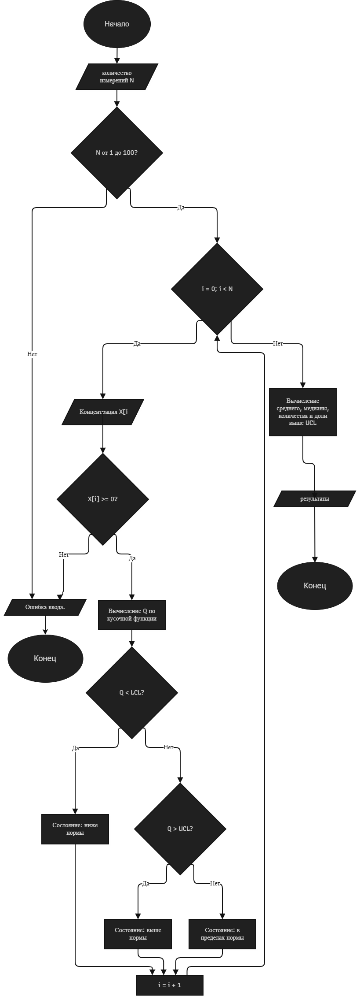

# Курсовой проект: Мониторинг концентрации вещества

## Анализ концентрации вещества с контролем границ LCL/UCL

### 1. Условие задачи

Разработать программу на языке **C** для обработки результатов измерения концентрации вещества.

Программа должна преобразовывать исходные значения концентрации в показатели $Q(x)$, проверять их относительно контрольных границ $LCL$ и $UCL$, а также выполнять статистическую обработку полученных результатов.

**Преобразование концентрации** выполняется по кусочной функции:

$$
Q(x) = 
\begin{cases}
3x + 2, & 0 \le x < 10, \\
1.5x + 17, & 10 \le x < 30, \\
0.7x + 41, & x \ge 30.
\end{cases}
$$

где $x \ge 0$ — концентрация вещества в мг/л.

**Контрольные границы:**
*   $LCL = 20$ — нижняя контрольная граница;
*   $UCL = 60$ — верхняя контрольная граница.

**Программа должна выполнять следующие действия:**
1. Считывать количество измерений и массив значений концентрации.
2. Вычислять значение $Q(x)$ для каждого измерения.
3. Определять состояние каждого измерения относительно контрольных границ.
4. Вычислять среднее арифметическое значений $Q$.
5. Находить медиану значений $Q$.
6. Подсчитывать количество значений $Q$, превышающих $UCL$.
7. Вычислять долю значений, превышающих $UCL$.

---

### 2. Входные и выходные данные

#### 2.1. Входные данные
*   $n$ — количество измерений;
*   $x[i]$ — значение концентрации вещества в мг/л.

**Ограничения:**
*   Количество измерений должно находиться в диапазоне от 1 до 100.
*   Значения концентрации должны быть неотрицательными.
*   При некорректном вводе программа завершает работу с сообщением об ошибке.

#### 2.2. Выходные данные
Программа выводит:
*   Исходные значения концентрации;
*   Вычисленные значения $Q(x)$;
*   Состояние каждого измерения;
*   Среднее арифметическое;
*   Медиану;
*   Количество значений выше $UCL$;
*   Долю значений выше $UCL$ в виде числа и процентов.

---

### 3. Алгоритм решения

#### 3.1. Описание алгоритма

1. Начать выполнение программы.
2. Установить русскую локализацию.
3. Ввести количество измерений $n$.
4. Проверить, что $n$ находится в диапазоне от 1 до 100.
5. Ввести значения концентрации вещества.
6. Проверить корректность каждого введённого значения.
7. Для каждого значения $x$ вычислить $Q(x)$ по заданной кусочной функции.
8. Сравнить полученное значение $Q$ с контрольными границами:
    *   если $Q < LCL$, состояние — *ниже нормы*;
    *   если $Q > UCL$, состояние — *выше нормы*;
    *   в остальных случаях состояние — *в пределах нормы*.
9. Вычислить среднее арифметическое значений $Q$.
10. Найти медиану значений $Q$.
11. Подсчитать количество значений, превышающих $UCL$.
12. Вычислить долю таких значений.
13. Вывести результаты.
14. Завершить программу.

#### 3.2. Блок-схема преобразования данных

Блок-схема отражает последовательность преобразования исходных данных и определения состояния измерения.

На схеме представлена следующая цепочка:
1. $X$ — исходное значение концентрации вещества.
2. $f(X)$ — преобразование исходного значения по заданной кусочной функции.
3. $Q$ — получение вычисленного значения.
4. $CONTROL$ — сравнение значения $Q$ с контрольными границами $LCL$ и $UCL$.
5. $STATE$ — определение состояния измерения.

Таким образом, схема отображает весь процесс преобразования данных:

$$
X \to f(X) \to Q \to CONTROL \to STATE
$$



---

### 4. Ручные расчёты

Для проверки правильности работы программы рассмотрим три примера.

**Пример 1.** Пусть $x = 5$.

Так как $0 \le 5 < 10$, используем первую формулу:
$$
Q(5) = 3 \cdot 5 + 2 = 17.
$$
Поскольку $17 < LCL = 20$, состояние — **ниже нормы**.

**Пример 2.** Пусть $x = 20$.

Так как $10 \le 20 < 30$, используем вторую формулу:
$$
Q(20) = 1.5 \cdot 20 + 17 = 47.
$$
Поскольку $20 \le 47 \le 60$, состояние — **в пределах нормы**.

**Пример 3.** Пусть $x = 40$.

Так как $40 \ge 30$, используем третью формулу:
$$
Q(40) = 0.7 \cdot 40 + 41 = 69.
$$
Поскольку $69 > UCL = 60$, состояние — **выше нормы**.

---

### 5. Реализация программы

#### 5.1. Используемые функции

Для реализации программы используются следующие функции:
*   `read_data()` — ввод и проверка исходных данных;
*   `compute_q()` — вычисление значения $Q(x)$;
*   `check_control()` — проверка значения относительно контрольных границ;
*   `compute_mean()` — вычисление среднего арифметического;
*   `compute_median()` — вычисление медианы;
*   `count_above()` — подсчёт значений, превышающих $UCL$.

Для хранения данных используются массивы. Для сортировки значений при вычислении медианы применяется сортировка пузырьком. Ввод и вывод данных выполняются в функции `main()`. Остальные функции выполняют отдельные вычисления и возвращают полученные результаты.

#### 5.2. Исходный код программы

```c
#include <stdio.h>
#include <locale.h>

#define MAX_N 100

#define LCL 20.0
#define UCL 60.0

#define BORDER_1 10.0
#define BORDER_2 30.0

#define K1 3.0
#define B1 2.0

#define K2 1.5
#define B2 17.0

#define K3 0.7
#define B3 41.0

int read_data(int *n, float x[]);
float compute_q(float x);
int check_control(float q);
float compute_mean(float q[], int n);
float compute_median(float q[], int n);
int count_above(float q[], int n);

int main()
{
    setlocale(LC_ALL, "Russian");

    int n;
    int i;
    int state;
    int count;

    float x[MAX_N];
    float q[MAX_N];

    float mean;
    float median;
    float fraction;

    printf("Программа анализа концентрации вещества\n\n");

    if (read_data(&n, x) == 0)
    {
        printf("Ошибка ввода данных!\n");
        return 1;
    }

    printf("\nРезультаты измерений:\n");

    for (i = 0; i < n; i++)
    {
        q[i] = compute_q(x[i]);

        state = check_control(q[i]);

        printf("\nИзмерение %d:\n", i + 1);
        printf("Концентрация: %.2f мг/л\n", x[i]);
        printf("Значение Q: %.2f\n", q[i]);

        if (state == -1)
        {
            printf("Состояние: ниже нормы\n");
        }
        else if (state == 1)
        {
            printf("Состояние: выше нормы\n");
        }
        else
        {
            printf("Состояние: в пределах нормы\n");
        }
    }

    mean = compute_mean(q, n);
    median = compute_median(q, n);
    count = count_above(q, n);

    fraction = (float)count / n;

    printf("\nСтатистические результаты:\n");

    printf("Среднее арифметическое: %.2f\n", mean);
    printf("Медиана: %.2f\n", median);
    printf("Количество значений выше UCL: %d\n", count);
    printf("Доля значений выше UCL: %.2f\n", fraction);
    printf("Доля в процентах: %.2f%%\n", fraction * 100);

    return 0;
}

int read_data(int *n, float x[])
{
    int i;

    printf("Введите количество измерений (1-%d): ", MAX_N);

    if (scanf("%d", n) != 1)
    {
        return 0;
    }

    if (*n < 1 || *n > MAX_N)
    {
        return 0;
    }

    for (i = 0; i < *n; i++)
    {
        printf("Введите концентрацию %d: ", i + 1);

        if (scanf("%f", &x[i]) != 1)
        {
            return 0;
        }

        if (x[i] < 0)
        {
            return 0;
        }
    }

    return 1;
}

float compute_q(float x)
{
    if (x < BORDER_1)
    {
        return K1 * x + B1;
    }
    else if (x < BORDER_2)
    {
        return K2 * x + B2;
    }
    else
    {
        return K3 * x + B3;
    }
}

int check_control(float q)
{
    if (q < LCL)
    {
        return -1;
    }
    else if (q > UCL)
    {
        return 1;
    }
    else
    {
        return 0;
    }
}

float compute_mean(float q[], int n)
{
    int i;
    float sum = 0;

    for (i = 0; i < n; i++)
    {
        sum = sum + q[i];
    }

    return sum / n;
}

float compute_median(float q[], int n)
{
    int i;
    int j;
    float temp;
    float a[MAX_N];

    for (i = 0; i < n; i++)
    {
        a[i] = q[i];
    }

    for (i = 0; i < n - 1; i++)
    {
        for (j = 0; j < n - 1 - i; j++)
        {
            if (a[j] > a[j + 1])
            {
                temp = a[j];
                a[j] = a[j + 1];
                a[j + 1] = temp;
            }
        }
    }

    if (n % 2 == 1)
    {
        return a[n / 2];
    }
    else
    {
        return (a[n / 2 - 1] + a[n / 2]) / 2;
    }
}

int count_above(float q[], int n)
{
    int i;
    int count = 0;

    for (i = 0; i < n; i++)
    {
        if (q[i] > UCL)
        {
            count++;
        }
    }

    return count;
}
```
### 6. Результаты работы программы

Для проверки программы используем следующие входные данные:

**Количество измерений:** 5

**Значения концентрации:** $5, 20, 40, 15, 8$

После выполнения преобразования получаем:

| № измерения | Концентрация $x$ | Значение $Q(x)$ | Состояние |
| :---: | :---: | :---: | :--- |
| 1 | 5 | 17 | Ниже нормы |
| 2 | 20 | 47 | В пределах нормы |
| 3 | 40 | 69 | Выше нормы |
| 4 | 15 | 39.50 | В пределах нормы |
| 5 | 8 | 26 | В пределах нормы |

#### 6.1. Вычисление среднего арифметического

Сумма полученных значений:

$$
17 + 47 + 69 + 39.5 + 26 = 198.5.
$$

Среднее арифметическое:

$$
\overline{Q} = \frac{198.5}{5} = 39.7.
$$

#### 6.2. Вычисление медианы

Расположим значения $Q$ в порядке возрастания:

$$
17;\ 26;\ 39.5;\ 47;\ 69.
$$

Так как количество значений нечётное, медианой является среднее значение:

**Медиана = 39.5.**

#### 6.3. Подсчёт значений выше UCL

Верхняя контрольная граница $UCL = 60$.

Только одно значение превышает верхнюю контрольную границу:

$$
69 > 60.
$$

Количество значений выше $UCL$:

**1.**

Доля таких значений:

$$
\frac{1}{5} = 0.2.
$$

В процентах:

$$
0.2 \cdot 100\% = 20\%.
$$

#### 6.4. Итоговые результаты

| Показатель | Результат |
| :--- | :--- |
| Среднее арифметическое | 39.70 |
| Медиана | 39.50 |
| Количество значений выше UCL | 1 |
| Доля значений выше UCL | 0.20 |
| Доля в процентах | 20% |

---

### 7. Информация о разработчике

- **Фамилия:** Гусакова
- **Имя:** Ксения
- **Группа:** БИЦТ-261
- **Язык программирования:** C
